<p align="center">
  
</p>

<h1 align="center">Airbnb Intelligence</h1>

<p align="center"><strong>Kathmandu Accommodation Analytics & Machine Learning Platform</strong></p>

<p align="center">
  Interactive analytics · Personalized recommendations · Price estimation · Model evaluation
</p>

---

Airbnb Intelligence is an academic and internship-oriented machine-learning project exploring accommodation listings, pricing, recommendation, and market context for Kathmandu, Nepal. It combines data-preparation workflows, machine-learning pipelines, evaluation reports, and a multi-workspace Streamlit dashboard.

> **Important scope note:** This is an analytics and demonstration project—not a booking platform. The prepared property and pricing data include synthetic samples. External benchmark datasets are not Kathmandu booking records, and the dashboard does not provide verified live listings, prices, or availability.

## Overview

### Key capabilities

- **Executive Analytics:** Explore listing and price distributions, neighbourhood comparisons, property types, KPIs, and tourism context.
- **Property Recommendations:** Filter properties and generate preference-based rankings or similar-property suggestions.
- **Price Prediction:** Estimate nightly prices from property and stay features using a trained regression pipeline.
- **Data Analysis:** Inspect prepared datasets, descriptive statistics, and visualizations.
- **Model Evaluation:** Review saved model metrics, comparisons, recommendation diagnostics, and prediction errors.
- **Cancellation Benchmark Study:** Inspect and preprocess an external hotel-booking benchmark for exploratory analysis.

## Dashboard Workspaces

| Workspace | What it provides |
|---|---|
| **Executive Analytics** | KPI summaries, market and pricing insights, neighbourhood comparisons, property-type analysis, distributions, and tourism context |
| **Property Recommendations** | Preference-based filtering, ranked results, similar-property discovery, and comparison |
| **Price Prediction** | Interactive inputs and estimated nightly accommodation price |
| **Data Analysis** | Dataset exploration, descriptive statistics, and visual analysis |
| **Model Evaluation** | Metrics, model comparisons, recommendation evaluation, and prediction diagnostics |

The dashboard is intended for exploration and demonstration. It does not process reservations or verify live availability.

## Machine Learning

### Property Recommendation System

The recommendation workflow combines structured preferences and listing text.

**Methods and signals**
- TF-IDF text vectorization and cosine similarity
- Property descriptions and amenities
- Neighbourhood, property type, and room type
- Budget compatibility
- Guest capacity, bedrooms, and bathrooms
- Rating and review-count signals
- Preference filters and weighted ranking

The prepared dataset contains **400 property records**, including **354 published properties**.

Recommendation evaluation scripts perform scenario-based checks and weight comparisons. Their scores are heuristic preference-match diagnostics—not ground-truth precision, recall, recommendation accuracy, or user satisfaction.

### Nightly Price Prediction

The current pipeline uses a **Gradient Boosting Regressor** with categorical, numerical, and amenity-text features.

**Target:** `base_price_npr`

Reported evaluation:

| Metric | Result |
|---|---:|
| MAE | NPR 148.33 |
| RMSE | NPR 218.93 |
| R² | 0.9942 |
| Baseline MAE | NPR 158.85 |
| MAE improvement | 6.62% |

**Property-level evaluation split**
- Training: 808 observations from 320 properties
- Testing: 192 observations from 80 properties
- Property IDs shared across train and test: **0**

These metrics come from prepared sample data and do not establish real-market pricing accuracy. The model uses the property's existing `nightly_price_npr` as an input feature and as the comparison baseline. The task is therefore to estimate the synthetic observed `base_price_npr` conditional on an already-known listing price and stay features—not to discover an unknown market price from property attributes alone. The baseline already achieves R² 0.9938, while Gradient Boosting reaches 0.9942 and reduces MAE by 6.62%; this is a modest improvement on synthetic data, not evidence of strong independent pricing power.

### Booking Cancellation Benchmark

The cancellation workflow examines the **Hotel Booking Demand** benchmark:

- Original dataset: 119,390 records and 25 columns
- Source domain: Portugal hotel bookings
- Exploratory cancellation rate: approximately 37.04%
- Preprocessing check: 119,209 rows after invalid-row removal

This is benchmark inspection and preprocessing—not a cancellation model trained on Kathmandu Airbnb booking data. No local Nepal cancellation labels are implied.

### Tourism Context

Monthly Nepal tourist-arrival data is used as national context only. National arrivals are not equivalent to Kathmandu accommodation occupancy, bookings, or room-night demand.

## Data

Processed datasets are expected under `data/processed/`.

| File | Description |
|---|---|
| `properties_clean.csv` | Property attributes, prices, ratings, amenities, descriptions, and publication fields |
| `price_observations_clean.csv` | Prepared price observations |
| `availability_clean.csv` | Availability/calendar information |
| `booking_cancellations_clean.csv` | External hotel cancellation benchmark |
| `nepal_monthly_tourist_arrivals_clean.csv` | National monthly tourist-arrival context |
| `recommendation_features.csv` | Recommendation model features |
| `price_prediction_features.csv` | Price model features |

### Data limitations and provenance

- Property records and price observations include **synthetic sample data**.
- Listings are not verified live Airbnb properties.
- Price observations are not verified live market prices.
- The cancellation benchmark is not linked to Kathmandu property IDs.
- Nepal-wide tourist arrivals do not measure Kathmandu accommodation demand.
- Occupancy and review data should only be used when valid observations are available.
- Results are suitable for development, testing, demonstration, and academic analysis—not operational decisions.

Do not interpret predictions as actual prices, recommendations as verified listings, or availability as live inventory.

## Repository Structure

```text
Airbnb-Intelligence/
├── assets/
│   ├── airbnb-intelligence-logo.svg
│   ├── airbnb-intelligence-icon.svg
│   └── dashboard-theme.css
├── app.py
├── requirements.txt
├── data/
│   ├── raw/
│   └── processed/
├── models/
│   ├── property_recommender.joblib
│   └── price_predictor.joblib
├── notebooks/
│   ├── Project_Report_and_Visual_Analysis.ipynb
│   ├── 01_data_audit_preprocessing/
│   ├── 02_price_prediction/
│   └── 03_accommodation_recommendation/
├── reports/
│   ├── price_model_metrics.csv
│   ├── price_predictions.csv
│   └── evaluation and analysis reports
├── scripts/
│   ├── evaluate_recommendation_quality.py
│   └── optimize_recommendation_weights.py
├── src/
│   ├── advanced_recommender.py
│   ├── booking_preprocessing.py
│   ├── prepare_ml_datasets.py
│   ├── train_price_model.py
│   ├── train_recommendation_model.py
│   └── validation and analysis modules
├── tests/
│   ├── test_recommendations.py
│   └── test_dashboard_smoke.py
└── README.md
```

Raw data files are expected in `data/raw/` for the data-audit workflow. Do not commit private, restricted, or personally identifiable information.

## Technology Stack

| Area | Tools |
|---|---|
| Language | Python |
| Data processing | Pandas, NumPy, SciPy |
| Machine learning | Scikit-learn |
| Model persistence | Joblib |
| Visualization | Matplotlib, Seaborn |
| Interactive dashboard | Streamlit |
| Testing | unittest, Streamlit AppTest |
| Development | Visual Studio Code |
| Version control | Git, GitHub |
| Data storage | CSV |

## Installation

**Prerequisites:** Python 3.12 or later and Git. The pinned NumPy release and the GitHub Actions quality workflow use Python 3.12.

### 1. Clone the repository

```bash
git clone https://github.com/Netrahoni/Airbnb-Intelligence.git
cd Airbnb-Intelligence
```

### 2. Create a virtual environment

```bash
python -m venv .venv
```

### 3. Activate it

**Windows PowerShell**
```powershell
.\.venv\Scripts\Activate.ps1
```

**Windows Command Prompt**
```bat
.\.venv\Scripts\activate.bat
```

**macOS / Linux**
```bash
source .venv/bin/activate
```

### 4. Install dependencies

```bash
python -m pip install --upgrade pip
python -m pip install -r requirements.txt
python -m pip check
```

## Run the Dashboard

Run from the repository root:

```bash
python -m streamlit run app.py
```

Streamlit will display a local URL. Open it in your browser to use the dashboard. On Windows, `python -m streamlit` is recommended over a standalone launcher, especially after recreating or moving the virtual environment.

## Project Report Notebook

Open [`notebooks/Project_Report_and_Visual_Analysis.ipynb`](notebooks/Project_Report_and_Visual_Analysis.ipynb) in Jupyter Notebook or VS Code.

The notebook provides:
- Project summary and objectives
- Workflow diagram
- Dataset inventory and audit
- Listing and price visualizations
- Neighbourhood and property-type analysis
- Tourism-context chart
- Recommendation-system overview
- Price model metrics and evaluation visualizations
- Cancellation benchmark exploration
- Outcomes, limitations, and conclusion

Install Jupyter if required:

```bash
python -m pip install notebook
jupyter notebook
```

Run notebook cells from top to bottom. Charts are generated from local processed datasets and report files. Missing artifacts are reported and skipped rather than replaced with fabricated values.

## Model & Dataset Workflows

Run commands from the repository root, and only when you intend to regenerate the corresponding artifacts.

### Prepare model features
```bash
python src/prepare_ml_datasets.py
```

### Train the recommendation model
```bash
python src/train_recommendation_model.py
```

### Train the price-prediction model
```bash
python src/train_price_model.py
```

### Validate the price model
```bash
python src/validate_price_model.py
```

### Evaluate recommendation scenarios
```bash
python scripts/evaluate_recommendation_quality.py
```

### Compare recommendation weights
```bash
python scripts/optimize_recommendation_weights.py
```

## Testing & Quality Checks

### Recommendation tests
```bash
python tests/test_recommendations.py
```

### Dashboard smoke tests
```bash
python -m unittest discover -s tests -p "test_dashboard_smoke.py" -v
```

### Compile Python files
```bash
python -m compileall -q app.py src scripts tests
```

### Dependency check
```bash
python -m pip check
```

The repository includes recommendation tests and Streamlit AppTest smoke coverage for dashboard workspaces. Run these locally to verify the current checkout; test outcomes may vary with the installed dependencies and available data files.

## Development Status

- [x] Data inspection and preprocessing workflows
- [x] Recommendation feature engineering
- [x] Personalized recommendation system
- [x] Similar-property recommendations
- [x] Recommendation scenario evaluation
- [x] Recommendation weight comparison
- [x] Price-prediction feature engineering
- [x] Gradient Boosting price model
- [x] Property-level train/test split
- [x] Price-model evaluation reports
- [x] Saved-model inference
- [x] Streamlit dashboard
- [x] Executive Analytics workspace
- [x] Data Analysis workspace
- [x] Model Evaluation workspace
- [x] Booking-cancellation benchmark inspection and preprocessing
- [ ] Validation with verified, permitted Kathmandu accommodation data
- [ ] Local occupancy and booking-history collection
- [ ] Real review data and validated sentiment analysis
- [ ] Further user-based recommendation evaluation

## Future Work

- Replace synthetic property and pricing samples with verified, permitted data.
- Validate price estimates against independent real-world observations.
- Improve recommendation evaluation with user feedback and unbiased metrics.
- Add temporal and geographic validation.
- Incorporate Kathmandu-specific occupancy and booking signals when available.
- Develop cancellation-risk modelling using appropriate booking-time features and trustworthy labels.
- Add review sentiment and aspect analysis after collecting permitted, validated reviews.
- Improve explainability, monitoring, reproducibility, and automated testing.

## Disclaimer

This repository is an academic and internship-oriented project for educational, analytical, and demonstration purposes.

The project uses prepared datasets, including synthetic sample data and external benchmark data. Recommendations, predictions, and visualizations are generated from those data and trained models. They do not represent official Airbnb information, verified live listings, actual transactions, confirmed availability, or guaranteed market prices.

Reported evaluation metrics describe performance on the available prepared datasets and evaluation scenarios. Real-world performance may differ.

This project is not affiliated with, endorsed by, or officially connected to Airbnb.

## Author & Repository

**Project:** Airbnb Intelligence  
**Repository:** [Netrahoni/Airbnb-Intelligence](https://github.com/Netrahoni/Airbnb-Intelligence)  
**Purpose:** Machine Learning Internship Project

---

## Visual Analysis & Output Report

The following figures are generated from the project's local processed datasets and saved evaluation reports. To generate or refresh the charts, run the report script from the repository root:

```bash
python scripts/generate_readme_report.py
```

Generated figures are saved under `reports/figures/`. The charts are only available in this README after the generated image files have been committed to GitHub. Missing datasets or report files are skipped; no sample values are invented.

### Executive Analytics

| Analysis | Output figure |
|---|---|
| Nightly price distribution | 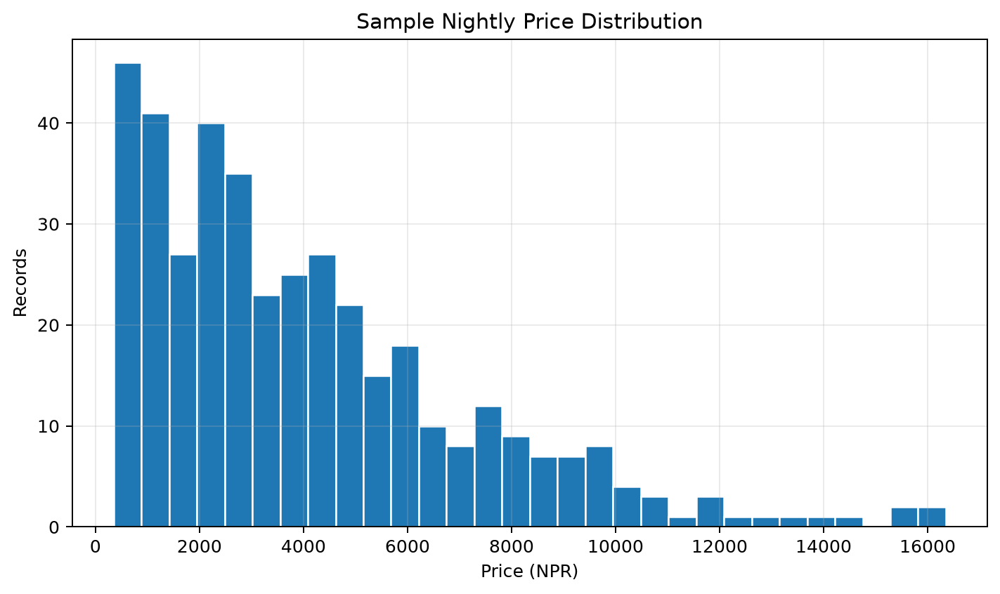 |
| Neighbourhood listing counts | 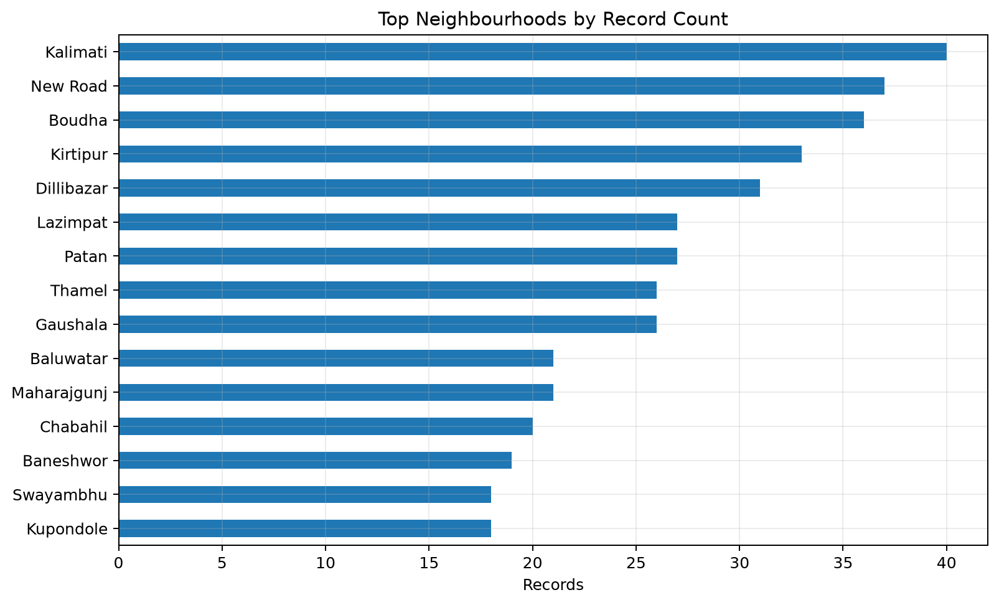 |
| Median price by neighbourhood | 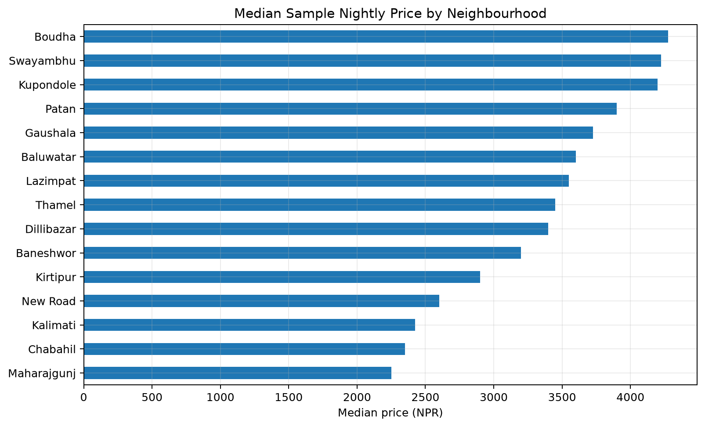 |
| Property type composition | 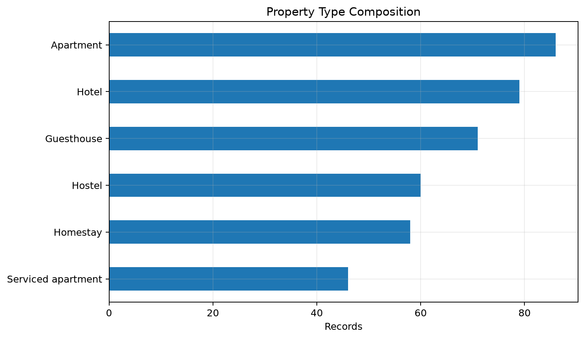 |
| Nepal tourist-arrival trend | 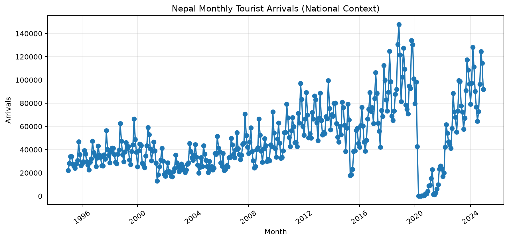 |

### Price Prediction & Model Evaluation

| Analysis | Output figure |
|---|---|
| Actual vs. predicted prices | 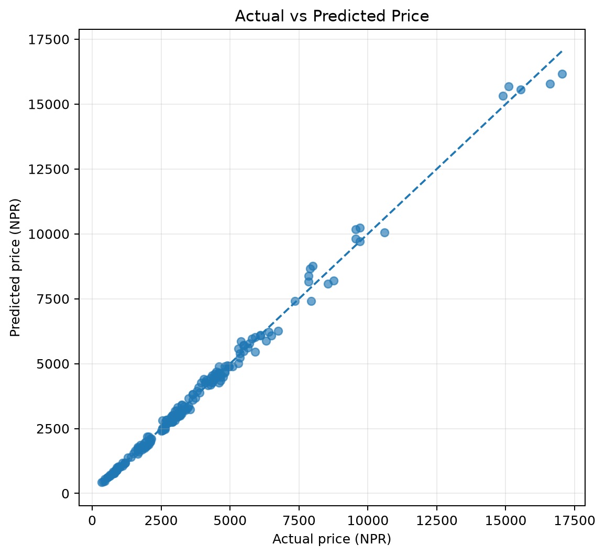 |
| Prediction error distribution | 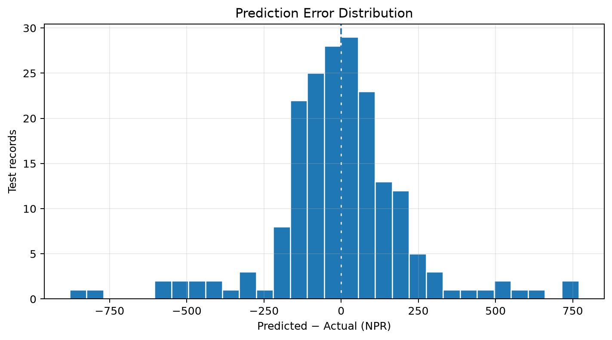 |
| Absolute prediction errors | 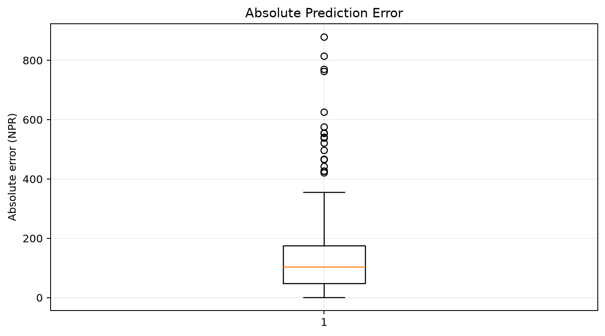 |
| Saved model metrics | 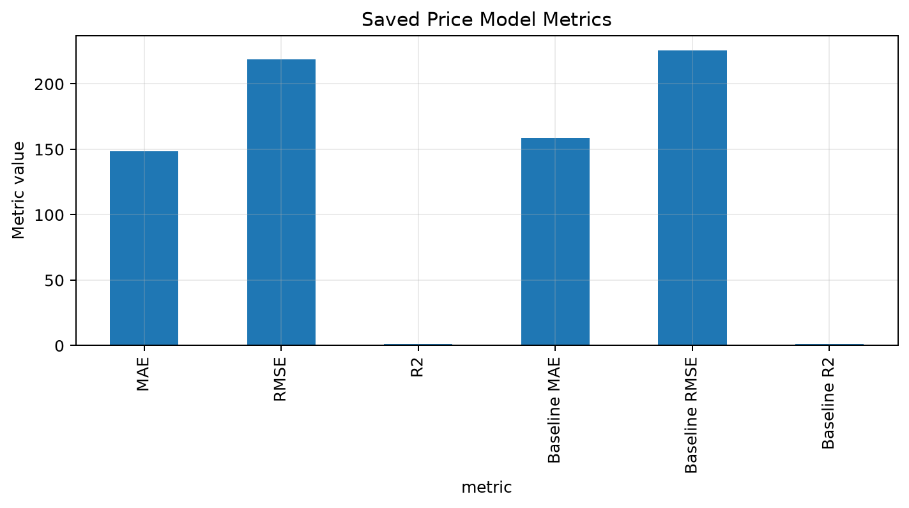 |
| Model comparison | See generated `model_comparison_*.png` figures in `reports/figures/`. |
| Cross-validation | See generated `cross_validation_*.png` figures in `reports/figures/`. |

### Recommendation System Evaluation

| Analysis | Output figure |
|---|---|
| Recommendation score summary | 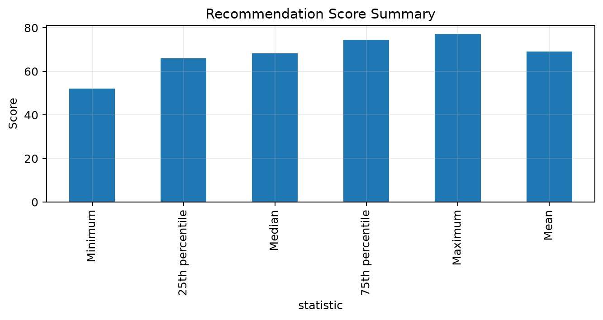 |
| Personalized recommendation scores | 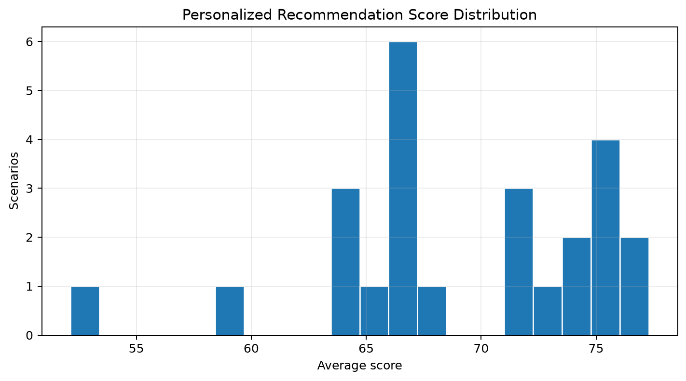 |
| Similar-property scores | 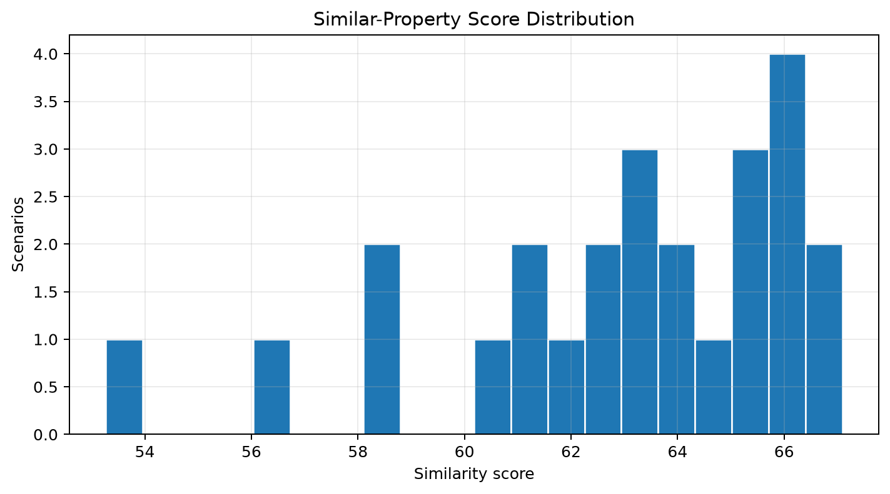 |
| Weight configuration comparisons | See generated `recommendation_weights_*.png` figures in `reports/figures/`. |

These recommendation charts represent scenario-based, heuristic diagnostics—not ground-truth recommendation accuracy or user satisfaction.

### Cancellation Benchmark

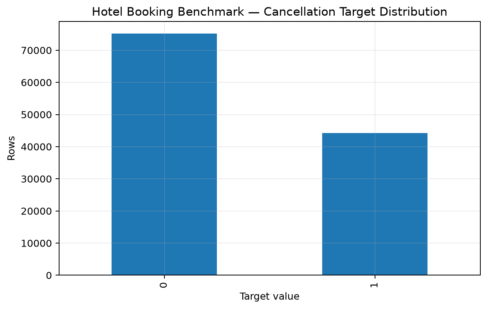

This figure is based on the external hotel-booking benchmark and is not Kathmandu Airbnb cancellation data.

### Report Files

The detailed CSV outputs are available in the `reports/` directory when generated locally, including model metrics, prediction-level records, cross-validation, model comparison, recommendation scenario results, and weight experiments. Figures and report outputs must be regenerated when datasets or model artifacts change.

> **Data integrity note:** Charts are generated from available files in the repository's `data/processed/` and `reports/` folders. Property and pricing data may contain synthetic samples; national tourism figures are contextual only; and the cancellation benchmark is external. Visuals should not be interpreted as verified live market data.
